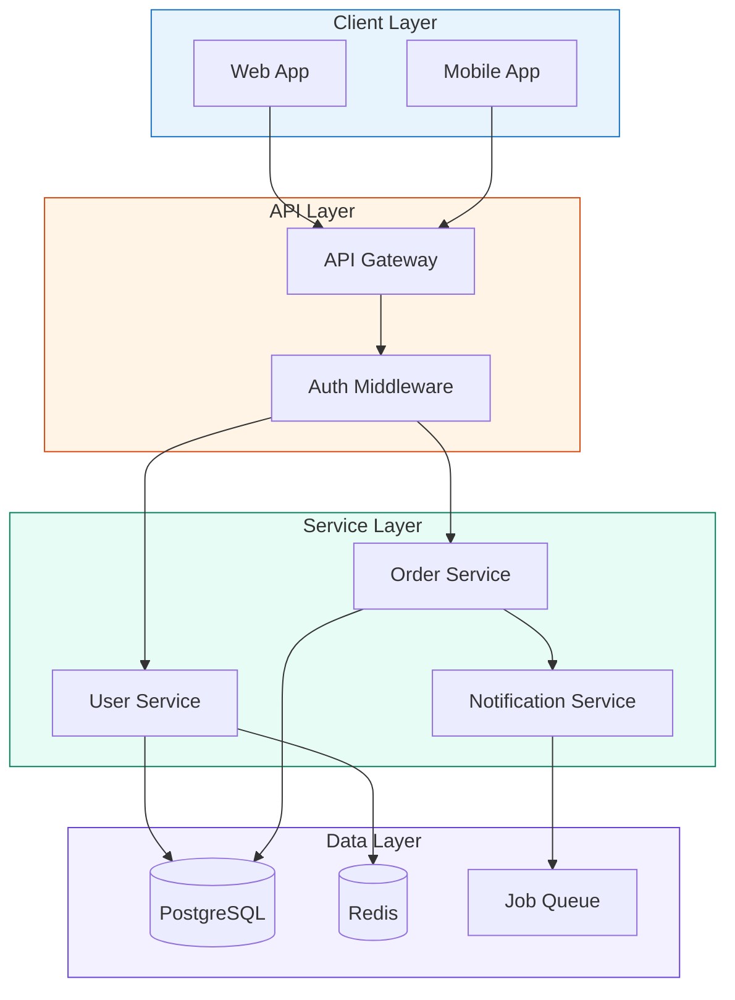
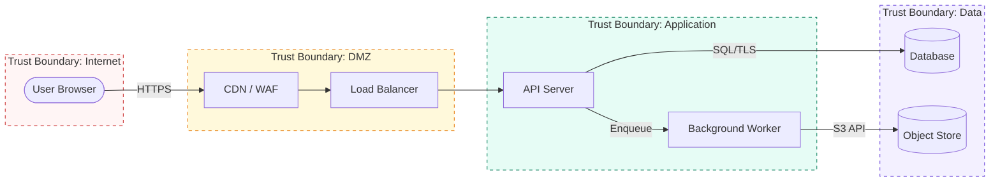
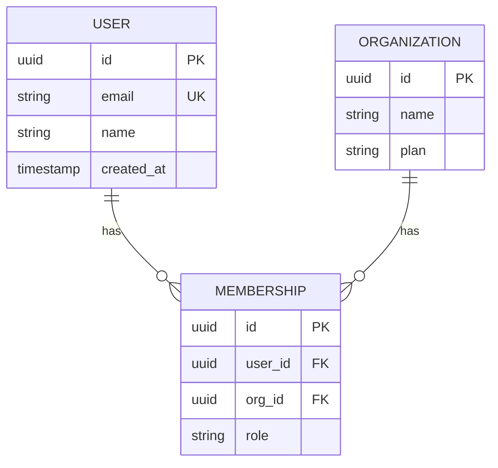
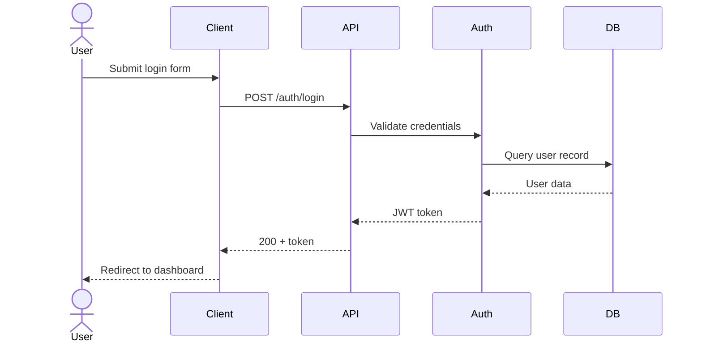
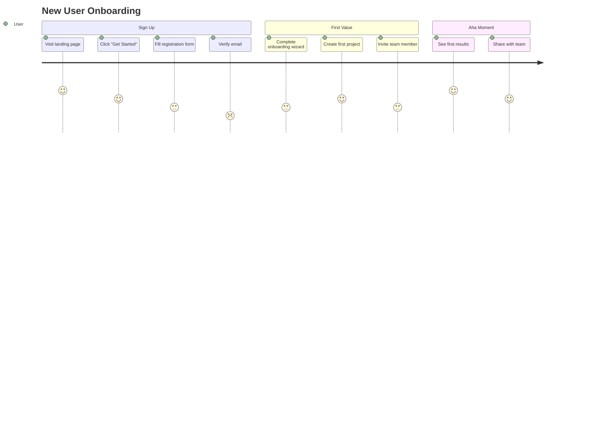

# Excalidraw — Technical Diagramming

## Reference
- **ID**: S-ENG-17
- **Category**: Engineering
- **Inputs**: RFC draft, PRD, company.config.yaml, codebase structure, threat model
- **Outputs**: Mermaid code blocks (inline in artifacts) + `.excalidraw` JSON files (`artifacts/diagrams/`)
- **Used by**: Engineering Agent (primary), Ops & Risk Agent (DFDs for threat models), Product Agent (user journeys)
- **Tool scripts**: `./tools/artifact/validate.sh`, `./tools/artifact/link.sh`

## Purpose

Fill the diagramming gap across Company OS workflows. Three skills reference diagrams as required outputs but nothing produces them:
- `architecture-draft` RFC template has `[Diagram + description]` placeholder
- `ai-engineering` requires an "Architecture Diagram — showing data flow through the AI pipeline"
- `threat-modeling` lists "data flow diagrams" as a required input

This skill provides the procedure, templates, and format references for producing structured diagrams in two formats.

## When to Use

- Creating or updating an RFC that needs system boundary diagrams
- Producing a data flow diagram for threat modeling
- Documenting entity relationships for a data model
- Creating user journey maps for PRDs or UX research
- Generating system overview diagrams for README or onboarding docs
- Any time a user runs `/excalidraw <type>`

## Diagram Types

| Type | Keyword | Mermaid Syntax | Excalidraw | Primary Consumer |
|------|---------|---------------|------------|-----------------|
| System architecture | `architecture` | `graph TD` | Yes | RFC "System Boundaries" |
| Data flow diagram | `data-flow` | `flowchart LR` | Yes | Threat model DFD |
| Entity-relationship | `erd` | `erDiagram` | Yes | RFC "Data Model" |
| Sequence diagram | `sequence` | `sequenceDiagram` | Mermaid only | RFC "API Surface" |
| User journey | `journey` | `journey` | Yes | PRD / UX research |
| System overview | `system-overview` | `graph TD` | Yes | README / onboarding |

## Output Format Decision

| Context | Format | Reason |
|---------|--------|--------|
| Embedded in an artifact (RFC, threat model, PRD) | **Mermaid** code fence | Agents can read/validate; renders in GitHub, Notion, Obsidian |
| Standalone documentation or deep architecture visual | **Excalidraw** JSON file | Richer layout, color, grouping; opened in Excalidraw/VS Code |
| User explicitly requests a format | Respect the request | — |
| Both are useful | Produce both | Mermaid inline + Excalidraw file |

## Procedure

### Step 0: Determine Scope

1. **If invoked via `/excalidraw <type>`**: use the keyword to select diagram type
2. **If invoked by another skill** (architecture-draft, threat-modeling): auto-detect type from context
3. **If no keyword**: scan the source artifact for clues:
   - RFC with `[Diagram + description]` → `architecture`
   - Threat model → `data-flow`
   - PRD with user flows → `journey`
   - Data model section → `erd`

### Step 1: Read Context

1. **Read `company.config.yaml`** — tech stack, architecture patterns, database choice
2. **Read the source artifact** (PRD/RFC/threat model) to understand what needs diagramming
3. **Scan existing code structure** — look at real directories, modules, services to ground the diagram in reality
4. **Check `artifacts/diagrams/`** for existing diagrams that may need updating rather than creating from scratch

### Step 2: Produce Mermaid Diagram

Select the appropriate Mermaid syntax for the diagram type. Follow the templates below.

**After writing Mermaid**: verify syntax by checking:
- All node IDs are unique within the diagram
- All edges reference existing node IDs
- No unclosed brackets or quotes
- Subgraph blocks are properly closed

### Step 3: Produce Excalidraw Diagram (if applicable)

If the diagram warrants a standalone Excalidraw file (architecture, data-flow, erd, journey, system-overview):

1. Use the Excalidraw JSON format reference below
2. Apply the Company OS color palette
3. Write to `artifacts/diagrams/{artifact-id}-{type}.excalidraw`
4. Reference `docs/diagrams/generate.js` for element factory patterns

**Skip Excalidraw** for sequence diagrams (Mermaid handles these better) and for simple diagrams with fewer than 5 nodes (Mermaid is sufficient).

### Step 4: Embed or Save

- **Mermaid**: replace the `[Diagram + description]` placeholder in the artifact with the fenced code block
- **Excalidraw**: write the JSON file and add a reference link in the artifact: `See [architecture diagram](artifacts/diagrams/{id}.excalidraw)`

### Step 5: Cross-reference

If the diagram is saved as a standalone file in `artifacts/diagrams/`:
1. Add YAML frontmatter with `type: diagram`
2. Set `depends_on` to the parent artifact (RFC, PRD, etc.)
3. Run `./tools/artifact/validate.sh` on the diagram file
4. Run `./tools/artifact/link.sh` to wire parent/child if needed

---

## Mermaid Templates

### Architecture Diagram (`graph TD`)



### Data Flow Diagram (`flowchart LR`)

Used for threat modeling. Show trust boundaries as subgraphs, data stores as cylinders, processes as rectangles, external entities as rounded boxes.



### Entity-Relationship Diagram (`erDiagram`)



### Sequence Diagram (`sequenceDiagram`)



### User Journey (`journey`)



---

## Excalidraw JSON Format Reference

### File Envelope

Every `.excalidraw` file is UTF-8 JSON:

```json
{
  "type": "excalidraw",
  "version": 2,
  "source": "https://excalidraw.com",
  "elements": [],
  "appState": { "viewBackgroundColor": "#ffffff", "gridSize": null },
  "files": {}
}
```

### Element Base Properties

Every element requires ALL of these fields:

```json
{
  "id": "unique-string",
  "type": "rectangle",
  "x": 100, "y": 200,
  "width": 160, "height": 80,
  "angle": 0,
  "strokeColor": "#1e1e1e",
  "backgroundColor": "transparent",
  "fillStyle": "solid",
  "strokeWidth": 2,
  "strokeStyle": "solid",
  "roughness": 0,
  "opacity": 100,
  "roundness": { "type": 3 },
  "seed": 1234567,
  "version": 1,
  "versionNonce": 7654321,
  "isDeleted": false,
  "groupIds": [],
  "frameId": null,
  "boundElements": [],
  "updated": 1709424000000,
  "link": null,
  "locked": false
}
```

### Element Types

| Type | Key Properties | Notes |
|------|---------------|-------|
| `rectangle` | `roundness: { type: 3 }` for rounded corners | Main building block |
| `diamond` | `roundness: { type: 2 }` | Decision nodes, gates |
| `ellipse` | `roundness: { type: 2 }` | Start/end nodes |
| `text` | `text`, `fontSize`, `fontFamily`, `textAlign`, `verticalAlign`, `containerId`, `originalText`, `autoResize: true`, `lineHeight: 1.25` | `fontFamily`: 1=hand-drawn, 2=Helvetica, 3=monospace |
| `arrow` | `points: [[0,0],[dx,dy]]`, `startBinding`, `endBinding`, `startArrowhead`, `endArrowhead` | Bindings are bidirectional |
| `line` | `points` array | Non-directional, no bindings |
| `frame` | `name` field | Children set `frameId` on themselves |

### Arrow Binding Rules (Critical)

Bindings MUST be bidirectional. When connecting arrow A from shape S1 to shape S2:

1. Arrow A gets: `startBinding: { elementId: "S1-id", focus: 0, gap: 6 }` and `endBinding: { elementId: "S2-id", focus: 0, gap: 6 }`
2. Shape S1 gets: `boundElements: [{ id: "A-id", type: "arrow" }]`
3. Shape S2 gets: `boundElements: [{ id: "A-id", type: "arrow" }]`

### Text Inside Shapes (Label Binding)

To place text T inside rectangle R:
1. Text T gets: `containerId: "R-id"`, `textAlign: "center"`, `verticalAlign: "middle"`
2. Rectangle R gets: `boundElements: [{ id: "T-id", type: "text" }]`
3. Position text at center: `x = R.x + (R.width - T.width) / 2`, `y = R.y + (R.height - T.height) / 2`

### Company OS Color Palette

Use these colors consistently across all diagrams:

| Domain | Background | Stroke |
|--------|-----------|--------|
| Orchestrator | `#e8f4fd` | `#1971c2` |
| Product | `#f3f0ff` | `#6741d9` |
| Engineering | `#e6fcf5` | `#087f5b` |
| Backend | `#d3f9d8` | `#2b8a3e` |
| Frontend | `#fff0f6` | `#a61e4d` |
| DevOps | `#fff9db` | `#e67700` |
| QA & Release | `#fff4e6` | `#d9480f` |
| Growth | `#f8f0fc` | `#862e9c` |
| Ops & Risk | `#fff5f5` | `#c92a2a` |
| Gates / warnings | `#fff3bf` | `#e67700` |
| Muted / disabled | `#f1f3f5` | `#adb5bd` |
| Status: draft | `#f8f9fa` | `#868e96` |
| Status: review | `#fff9db` | `#e67700` |
| Status: approved | `#ebfbee` | `#2b8a3e` |
| Text primary | — | `#1e1e1e` |
| Text secondary | — | `#495057` |
| Text muted | — | `#868e96` |

### Design Conventions

- **roughness: 0** — clean, professional lines (not hand-drawn)
- **fontFamily: 2** — Helvetica for all text
- **fontSize: 16** — default for labels inside shapes
- **fontSize: 12-13** — for sub-labels and annotations
- **fontSize: 20-24** — for titles and major section headers
- **strokeWidth: 2** — default for all shapes and arrows
- **strokeWidth: 1** — for pills, minor elements, and dense layouts
- **gap: 6** — standard arrow binding gap
- **Element ordering**: z-order follows array position (index 0 = back). Background zones first, then shapes, then arrows, then text annotations.
- **Frame children** must appear BEFORE the frame element in the elements array.

### Reference Implementation

See `docs/diagrams/generate.js` for a complete Node.js generator that demonstrates:
- Element factory functions (`rect()`, `textEl()`, `arrow()`, `labeledBox()`, `connect()`)
- Bidirectional binding management
- Deterministic ID generation for clean git diffs
- Layout helpers and text width estimation
- All 6 Company OS architecture diagrams as working examples

---

## Cross-References

- **architecture-draft** (S-ENG-01): Use this skill at Step 3 "Define System Boundaries" to produce the architecture diagram
- **threat-modeling** (S-RISK-01): Use this skill at Step 2 "Draw the DFD" to produce the data flow diagram
- **ai-engineering** (S-ENG-16): Use this skill for the "Architecture Diagram — showing data flow through the AI pipeline"
- **seed-data** (S-ENG-11): Use the ERD template for entity-relationship diagrams
- **user-docs** (S-ENG-10): Reference Excalidraw diagrams as visual aids in user documentation

## Quality Checklist

- [ ] Diagram reflects the actual codebase structure (not aspirational architecture)
- [ ] All nodes have clear, concise labels
- [ ] Arrows show data/control flow direction correctly
- [ ] Color palette matches Company OS domain colors
- [ ] Mermaid syntax validates (no broken references or unclosed blocks)
- [ ] Excalidraw JSON is valid (all bindings bidirectional, all IDs unique)
- [ ] Diagram has a title and brief description
- [ ] Linked to parent artifact via `depends_on` (for standalone files)
- [ ] No sensitive information (API keys, credentials) in diagram labels
